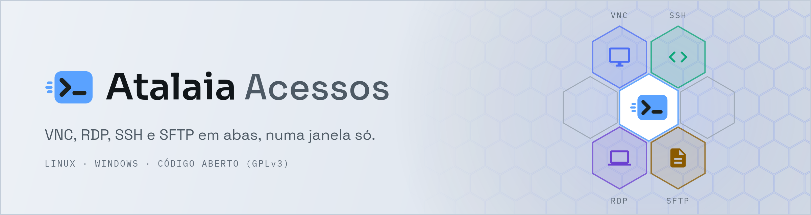
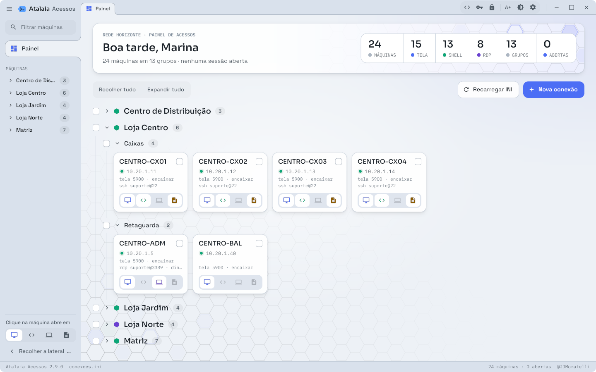
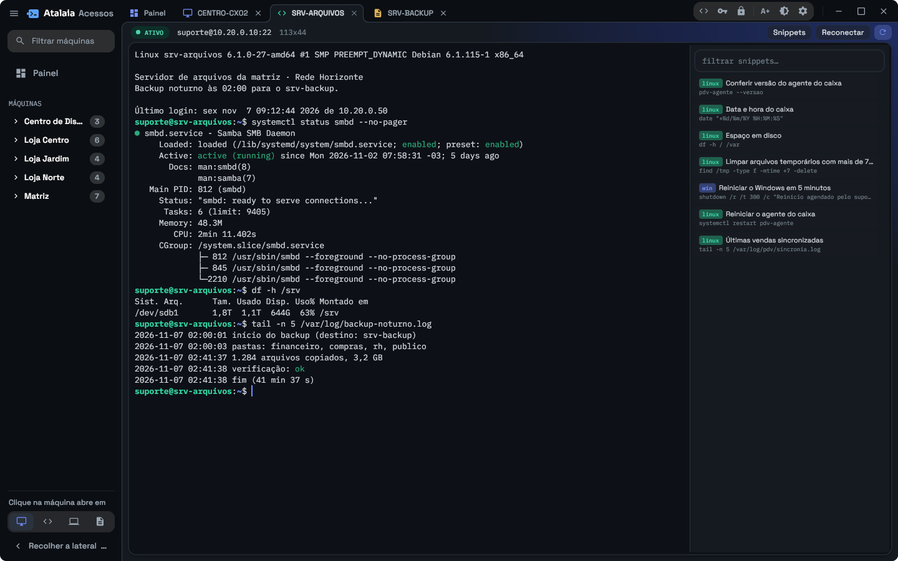
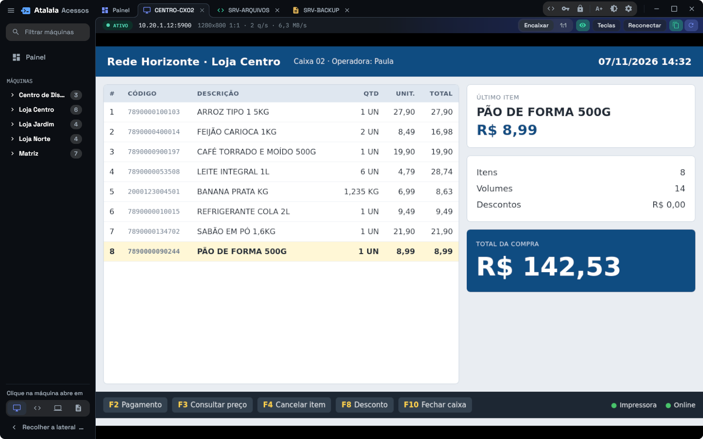
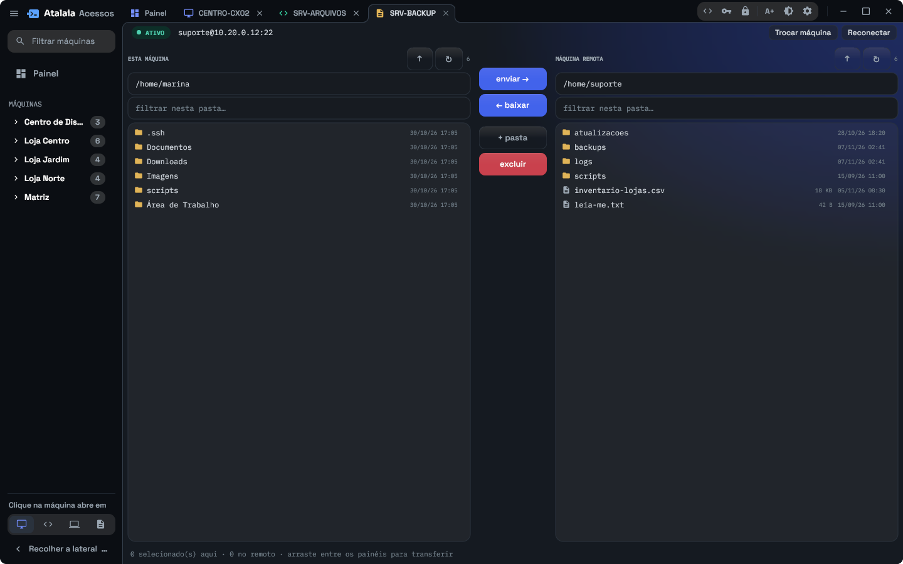
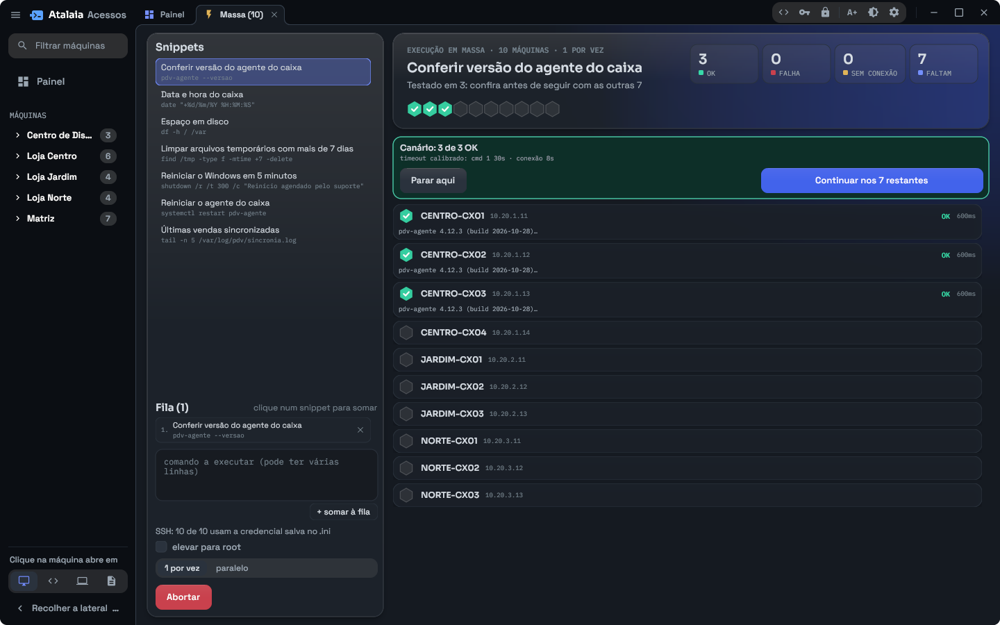
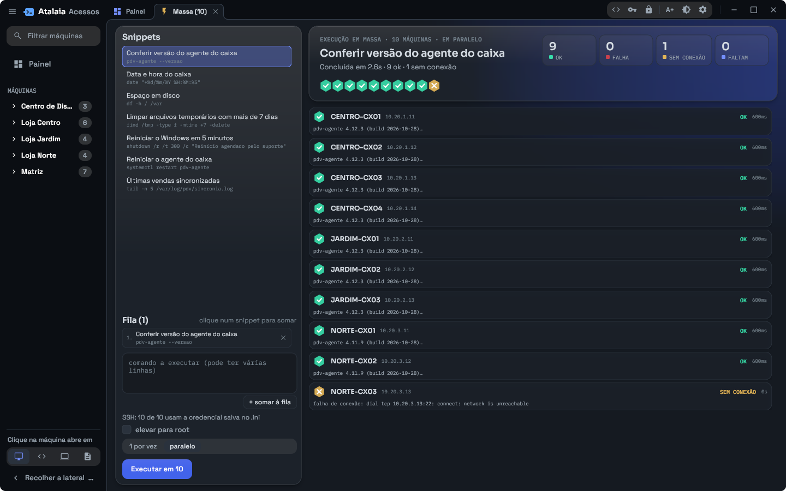
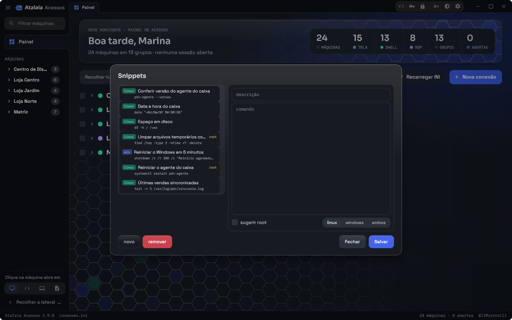
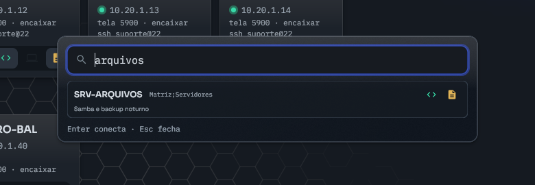
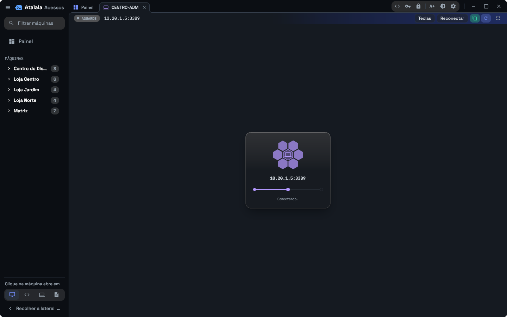

# Atalaia Acessos

<picture>
  <source media="(prefers-color-scheme: dark)" srcset="icones/banner-escuro.png">
  
</picture>

O Atalaia Acessos junta numa janela só o que o suporte usa para chegar nas
máquinas: a tela (VNC), a área de trabalho do Windows (RDP), o terminal (SSH)
e os arquivos (SFTP). Cada máquina abre numa aba, o Painel mostra quem está
respondendo, e um atalho de teclado acha qualquer máquina sem precisar ir até
o programa.

Roda no Linux (Flatpak) e no Windows, a partir do mesmo código.

<picture>
  <source media="(prefers-color-scheme: dark)" srcset="screenshots/principal.png">
  
</picture>

<sub>As imagens usam um inventário de demonstração: empresa, máquinas, pessoas e endereços são fictícios.</sub>

## O que ele faz

- **Painel com todas as máquinas**, em grupos e subgrupos (lojas, setores,
  servidores), cada uma com um ponto que diz se ela está respondendo. O
  filtro procura por nome, endereço ou grupo, e clicar no cartão abre a
  máquina no protocolo escolhido.
- **Sessões em abas.** VNC e RDP embutidos, com a imagem ajustada ao tamanho
  da aba; terminal SSH com a biblioteca de comandos ao lado; SFTP com a sua
  máquina de um lado e a remota do outro, arrastando arquivos entre as duas.
- **RDP em janela própria**, inclusive em tela cheia, sem derrubar a sessão.
- **Execução em massa**: o mesmo comando em dezenas de máquinas, testado
  antes em três, com o resto esperando a sua confirmação.
- **Busca de qualquer lugar** com `Ctrl+Shift+F12`: uma caixa aparece por
  cima do que estiver na tela, você digita parte do nome e a máquina abre
  numa aba.
- **Destino avulso**: um endereço que não está cadastrado (`10.1.1.99`,
  `suporte@10.1.1.99`, `rdp servidor`) vira conexão na hora, sem cadastro.
- **Senhas protegidas**: o cofre cifra as senhas salvas com uma senha mestra,
  e o chaveiro guarda credenciais que várias máquinas usam, chamadas por um
  apelido.
- **Identidade do servidor conferida**: chave SSH e certificado RDP novos ou
  trocados aparecem para você decidir, e nunca são aceitos sozinhos.
- **Atualização pelo próprio app**: quando sai versão nova ele avisa e
  instala por cima, na hora que você escolher.
- Tema claro e escuro, letra maior com um clique (`A+`) e barra lateral que
  recolhe com `F12`.

## Telas

**Terminal SSH**, com os snippets ao lado: um clique manda o comando para a
sessão.



**Tela remota (VNC)**, aqui no caixa de uma loja.



**Arquivos (SFTP)**: esta máquina à esquerda, a remota à direita.



**Execução em massa.** O comando roda primeiro em três máquinas; só depois
que você confere o resultado ele segue para as outras, uma por vez ou em
paralelo.





**Biblioteca de snippets**, os comandos que você usa sempre, com a
plataforma e a indicação de quem precisa de root.



**`Ctrl+Shift+F12`**, de qualquer lugar: a caixa aparece por cima do que
estiver na tela, e a máquina escolhida abre numa aba.



Enquanto uma conexão abre, os favos pulsam em volta do ícone do protocolo;
se ela falha, viram um × vermelho.



## Instalar

Os pacotes ficam na página de
[versões](https://github.com/JMoratelli/atalaia/releases/latest).

**Linux.** Baixe o `org.jj.Acessos-<versão>.flatpak` e instale para o seu
usuário:

```bash
flatpak install --user org.jj.Acessos-2.9.0.flatpak
```

O pacote usa o runtime `org.freedesktop.Platform` 25.08, que o Flatpak busca
no Flathub se ainda não estiver instalado. Depois é só abrir pelo menu de
aplicativos ou com `flatpak run org.jj.Acessos`.

**Windows.** Baixe o `AcessosSetup-<versão>.exe` e execute. Ele instala só
para o seu usuário, sem pedir administrador, e cria o atalho no Menu Iniciar.

Daí em diante as atualizações chegam pelo próprio app.

## Primeiros passos

Na primeira vez o app cria um inventário de exemplo. As máquinas são
cadastradas pelo botão **Nova conexão** no Painel, ou direto no
`conexoes.ini`, que é um texto simples com uma seção por máquina:

```ini
[CAIXA-01]
grupo = Loja Centro;Caixas
host = 10.20.1.11
descricao = Caixa 1, entrada
vnc = 1
ssh = 1
ssh_usuario = suporte
```

| Onde o inventário fica | |
|---|---|
| Linux (Flatpak) | `~/.var/app/org.jj.Acessos/config/acessos/conexoes.ini` |
| Linux (compilado à mão) | `~/.config/acessos/conexoes.ini` |
| Windows | `%APPDATA%\acessos\conexoes.ini` |

Para guardar o inventário numa pasta sincronizada, aponte para ela com
`caminho` na seção `[geral]`. Para salvar senhas cifradas, clique no cadeado
no topo da janela e crie a senha mestra.

## Documentação

- [Inventário e preferências](docs/inventario.md): o `conexoes.ini` campo a
  campo, grupos e a seção `[geral]`.
- [Uso no dia a dia](docs/uso.md): Painel, abas, sessões, destino avulso e
  atalhos de teclado.
- [Execução em massa e snippets](docs/execucao-em-massa.md)
- [Senhas e identidade dos servidores](docs/senhas.md): cofre, chaveiro,
  chaves SSH e certificados RDP.
- [Atalho global](docs/atalho-global.md): o `Ctrl+Shift+F12` e o serviço que
  o mantém valendo com o app fechado.
- [Compilar](docs/compilar.md): Flatpak, build de desenvolvimento, Windows a
  partir do Linux e a organização do código.

## A versão em Python (1.x)

Até a 1.x o app era escrito em Python. Desde a 2.0 ele é escrito em Go, com
a interface desenhada na GPU, e lê os mesmos arquivos de antes
(`conexoes.ini`, `chaveiro.ini`, `snippets.ini`), no mesmo lugar: atualizar
da 1.x não pede migração. O código antigo continua acessível:

```bash
git checkout v1.2.2     # a última versão publicada em Python
git checkout 1.x        # a linha de manutenção
```

## Licença

GNU GPLv3. Veja [LICENSE](LICENSE).

## Sobre o desenvolvimento

Desenvolvido com IA, revisado por mim
  Este repositório utiliza inteligência artificial no processo criativo (vibecoding). No entanto, todo o código é revisado, testado e mantido 100% manualmente por mim, garantindo cuidado em cada detalhe como único mantenedor do projeto (por enquanto).

AI-Assisted, Human-Crafted
  This repository leverages artificial intelligence during the creative process (vibecoding). However, all code is 100% manually reviewed, tested, and maintained by me, ensuring care and quality as a solo maintainer (for now).
