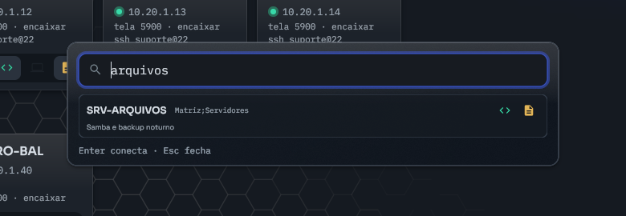

# Atalho global (`Ctrl+Shift+F12`)



`Ctrl+Shift+F12` abre uma caixa de busca pequena por cima do que estiver na
tela, sem precisar ir até a janela do programa. Digite parte do nome, do
endereço, do grupo ou da descrição da máquina e escolha: ela abre numa aba
nova, com a janela do Atalaia Acessos vindo para a frente junto. Máquina que já
está aberta troca para a aba dela.

Cada resultado traz a mesma fileira de ícones do Painel: clicar no ícone abre
aquele protocolo, `Enter` abre o preferido e `Esc` fecha. Um endereço que não
está cadastrado aparece como última linha quando a busca não acha nada (o
[destino avulso](uso.md#filtro-e-destino-avulso)).

O atalho pode ser desligado nos Ajustes (engrenagem no topo).

## No Linux

No Wayland quem amarra a tecla é o sistema, pelo portal `GlobalShortcuts`. O
app pede `Ctrl+Shift+F12` e o KDE confirma **uma vez só**, na primeira
execução. Se esse diálogo for recusado, o atalho fica registrado sem tecla e
pode ser amarrado em Preferências do Sistema → Atalhos → Atalaia Acessos; os
Ajustes avisam quando isso acontece.

O atalho vale **com o app fechado**. Quem o segura é um processo pequeno e sem
janela (`acessos -servico`), que sobe junto com o app na primeira vez e
continua vivo depois que a janela fecha. Com o app aberto o atalho abre a
caixa nele; com o app fechado a caixa nasce no serviço e a janela grande só
sobe quando uma máquina for escolhida.

O mesmo serviço garante **uma janela só**: abrir o Atalaia Acessos de novo
manda o pedido para a janela que já existe em vez de abrir uma segunda.

### Depois do login

Para o atalho existir logo depois do login, sem ninguém abrir o app antes, o
serviço pede ao sistema, uma vez, permissão para subir sozinho (portal
`Background`). A resposta fica em `[geral] atalho_autostart` (`1` aceito, `0`
recusado). Para mudar de ideia, use a caixa **manter o atalho valendo depois do
login** nos Ajustes: desmarcá-la revoga o autostart no sistema, e não só a
chave do arquivo.

### O serviço

O serviço é separado de propósito e não morre junto com a janela. Uma versão
nova do app pede a vaga sozinha ao subir, então numa atualização normal não é
preciso fazer nada. Para derrubá-lo à mão:

```bash
pkill -f "acessos -servico"
```

O socket dele fica em `$XDG_RUNTIME_DIR/acessos/servico.sock`.

## No Windows

No Windows quem amarra a tecla é o próprio app, com `RegisterHotKey`: sem
diálogo de confirmação e sem serviço. Em compensação o atalho só existe com o
app aberto.
