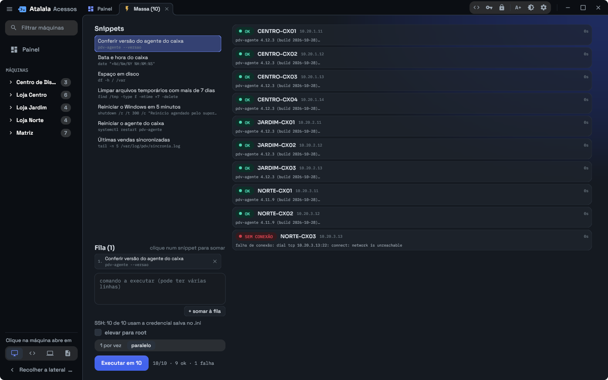
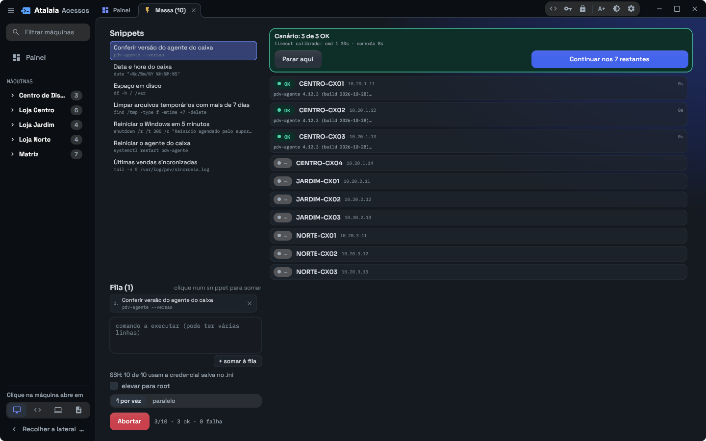
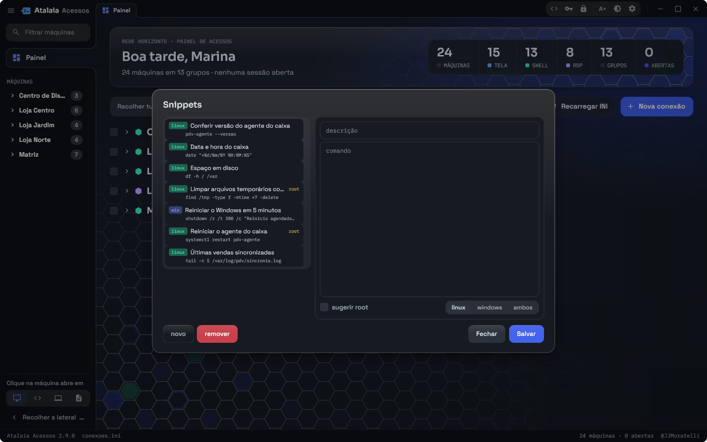

# Execução em massa e snippets

A execução em massa roda os mesmos comandos em várias máquinas de uma vez,
pelo SSH: conferir a versão de um programa nos caixas de todas as lojas,
reiniciar um serviço, limpar arquivos temporários.



## Abrindo

No Painel, marque as máquinas (ou um grupo inteiro, pela caixinha do grupo) e
clique em **Executar em N**. Abre uma aba **Massa (N)** com as máquinas
marcadas.

À esquerda fica o que vai rodar:

- **Snippets**: a biblioteca de comandos prontos. Clicar num deles o soma à
  fila.
- **Fila**: os comandos, na ordem em que vão rodar. Eles rodam na mesma sessão
  de cada máquina, então um `cd` ou uma variável definida num comando continua
  valendo no seguinte.
- O campo de comando, para escrever algo que não está na biblioteca. O que
  estiver escrito ali conta como o último comando da fila, mesmo sem clicar em
  **+ somar à fila**.

À direita fica cada máquina, com o estado, a primeira linha da saída e o tempo
que levou. Clicar numa linha mostra a saída inteira.

## Credenciais

Cada máquina usa a credencial SSH cadastrada para ela no inventário (inclusive
as que estão no cofre ou no chaveiro). Os campos de usuário e senha da aba só
aparecem quando alguma máquina não tem credencial salva, e valem só para
essas.

Se alguma senha estiver no cofre e ele estiver trancado, a senha mestra é
pedida ao abrir a aba e de novo ao executar.

**elevar para root** faz cada máquina entrar como root com `su -` antes de
rodar a fila, usando a senha de root digitada ao lado. Um snippet marcado como
"root" liga isso sozinho.

Máquinas marcadas como Windows no inventário (`windows = 1`) recebem os
comandos pelo PowerShell e não passam pela elevação.

## Uma por vez ou em paralelo

- **1 por vez**: uma máquina de cada vez. É o modo mais seguro, porque uma
  falha para a fila antes da próxima máquina.
- **paralelo**: até oito máquinas ao mesmo tempo. Bem mais rápido em parque
  grande; quando aparece uma falha, as outras que já estavam rodando terminam.

## O teste em três máquinas

Qualquer que seja o modo, o comando roda primeiro em **três** máquinas, uma
depois da outra, e a execução para para você conferir:



São três, e não uma, porque uma máquina só não separa "o comando está errado"
de "esta máquina está com problema". O tempo que elas levaram também serve
para calibrar o limite de tempo das demais: um comando lento não é cortado por
um prazo chutado.

**Continuar nos N restantes** solta o resto; **Parar aqui** encerra ali.

## Quando um comando falha

Um comando que termina com erro (código de saída diferente de zero) para a
execução e pergunta o que fazer:

| Botão | O que acontece |
|---|---|
| **Continuar nesta** | segue com os próximos comandos nesta máquina |
| **Pular esta** | abandona esta máquina e segue com as outras |
| **Continuar sem perguntar** | segue tudo e não pergunta mais nesta execução |
| **Abortar tudo** | para tudo agora |
| **ver saída** | mostra o que o comando escreveu antes de decidir |

Máquina desligada ou fora da rede nunca para a execução: ela aparece como
**sem conexão** e as outras seguem.

## A biblioteca de snippets



Os snippets aparecem na aba de execução em massa e no painel ao lado do
terminal SSH. O editor abre pelo botão `<>` no topo da janela: **novo**,
**remover**, e à direita a descrição, o comando, a plataforma e a indicação de
root.

Eles ficam no `snippets.ini`, ao lado do inventário, e o arquivo pode ser
editado à mão:

```ini
[versao_agente]
descricao    = Conferir versão do agente do caixa
plataforma   = linux
root         = nao
ignorar_exit = nao
comando      = pdv-agente --versao

[espaco_disco]
descricao    = Espaço em disco
plataforma   = linux
root         = nao
ignorar_exit = nao
comando      = df -h /
               df -h /var
```

| Campo | Valores | O que faz |
|---|---|---|
| `descricao` | texto | o nome que aparece na lista |
| `plataforma` | `linux`, `windows`, `ambos` | para que tipo de máquina o comando serve |
| `root` | `sim`, `nao` | sugere a elevação para root |
| `ignorar_exit` | `sim`, `nao` | não tratar código de saída diferente de zero como falha |
| `comando` | texto | o comando; as linhas seguintes, recuadas, fazem parte dele |
