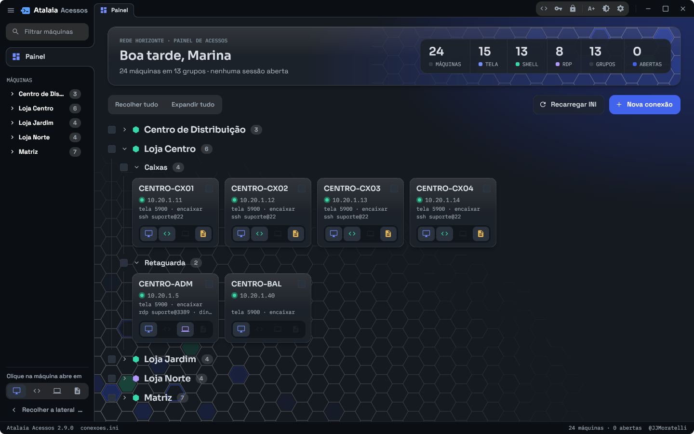
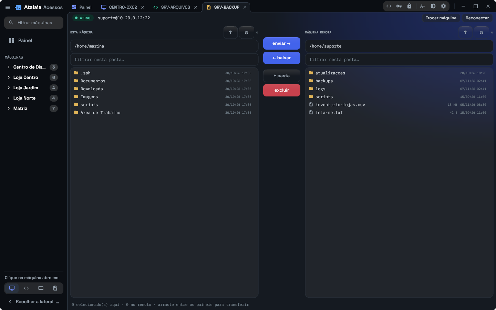

# Uso no dia a dia

## Painel

O Painel é a primeira aba e não fecha. No alto, o cartão de boas-vindas
resume o inventário: quantas máquinas, quantas com tela, terminal e RDP,
quantos grupos e quantas sessões estão abertas.

Embaixo vêm os grupos, que abrem e fecham com um clique (**Recolher tudo** e
**Expandir tudo** fazem isso de uma vez). Cada máquina é um cartão com:

- o ponto de vida: verde quando a máquina responde, vermelho quando não;
- o endereço e um resumo de cada protocolo cadastrado (porta, usuário, modo);
- a fileira de ícones: tela, terminal, RDP e arquivos. Clicar num ícone abre
  aquele protocolo; ícone apagado é protocolo que a máquina não tem.

Clicar no cartão fora dos ícones abre o protocolo escolhido em **Clique na
máquina abre em**, no pé da barra lateral.

O botão direito no cartão traz **Editar…**, **Duplicar…** (cadastra a próxima
máquina, com o nome e o IP já incrementados), **Detectar plataforma** (descobre
se é Linux ou Windows pela apresentação do servidor SSH, sem mandar senha
nenhuma), **Copiar host** e **Remover…**.

### Filtro e destino avulso

O campo **Filtrar máquinas**, na barra lateral, procura por nome, endereço,
grupo e descrição, e abre sozinho os grupos onde achou alguma coisa.

Quando o que foi digitado não está cadastrado, aparece um cartão temporário
para conectar assim mesmo:

| Digitado | Abre |
|---|---|
| `10.1.1.99` | a tela (VNC, porta 5900) |
| `10.1.1.99:22` | o terminal: a porta decide o protocolo |
| `suporte@10.1.1.99` | o terminal, com esse usuário |
| `rdp servidor` | o RDP: o prefixo manda |

O app pede usuário e senha na hora e não grava nada: a conexão vive enquanto
a aba estiver aberta.

### Várias máquinas de uma vez

As caixinhas dos cartões e dos grupos marcam máquinas. Com alguma marcada
aparece uma barra com o total e as ações **Executar em N**, que abre a
[execução em massa](execucao-em-massa.md), remover as marcadas e limpar a
seleção.

## Abas e sessões

Cada sessão abre numa aba, com o ícone colorido do protocolo. Abrir de novo
uma máquina que já está aberta volta para a aba dela em vez de abrir outra.

Enquanto conecta, a aba mostra o favo pulsando em volta do ícone do protocolo.
Se a conexão falha, os favos viram um × vermelho e a mensagem diz o motivo.

Acima de cada sessão fica uma barra fina com o estado, o destino e a
resolução, e as ações daquela sessão:

- **Tela (VNC):** **Encaixar** ou **1:1**, o olho que alterna entre controlar
  e só ver, **Teclas**, **Reconectar**.
- **RDP:** **Teclas**, **Reconectar** e os botões de destacar a sessão numa
  janela própria e de tela cheia. Na janela destacada a mesma barra continua
  lá, com o botão de devolver a aba; destacar e devolver não reconectam.
- **Terminal (SSH):** **Snippets**, que abre a biblioteca de comandos ao lado
  do terminal (um clique manda o comando para a sessão), e **Reconectar**.
- **Arquivos (SFTP):** **Trocar máquina** e **Reconectar**.

O menu **Teclas** envia combinações que o computador local pegaria para si:
`Ctrl+Alt+Del`, `Alt+F4`, `Alt+Tab`, `Ctrl+Esc`, `Super`, `Ctrl+Shift+Esc`,
`Ctrl+Alt+F1`, `Ctrl+Alt+F2` e `PrintScreen`.

A área de transferência de texto é compartilhada com a tela e o RDP: copiar de
um lado e colar do outro funciona nos dois sentidos.

### Arquivos (SFTP)

À esquerda fica esta máquina, à direita a remota. Arraste arquivos de um lado
para o outro, ou marque e use **enviar** e **baixar**. **+ pasta** cria uma
pasta, **excluir** apaga os itens marcados (pedindo confirmação), e o campo
**filtrar nesta pasta** ajuda em pastas grandes. **Trocar máquina** aponta o
mesmo painel para outra máquina sem fechar a aba.

## Atalhos de teclado

| Tecla | O que faz |
|---|---|
| `Ctrl+Shift+F12` | a busca rápida, de qualquer lugar ([atalho-global.md](atalho-global.md)) |
| `F12` | recolhe e abre a barra lateral |
| `Ctrl+W` | fecha a aba atual (fora de uma sessão; dentro dela a tecla vai para a máquina remota) |
| `Ctrl+Shift+V` | cola no terminal SSH |
| `Enter` | confirma o diálogo aberto |
| `Esc` | fecha o diálogo aberto |

Dentro de uma sessão o teclado é da máquina remota. Para mandar uma
combinação que o computador local pegaria para si, use o menu **Teclas**.

## Aparência

No topo da janela, à direita: o botão de contraste troca entre o tema claro e o
escuro, e o `A+` aumenta a letra de toda a interface, um degrau por clique (no
último degrau ele volta ao tamanho padrão). As duas escolhas ficam gravadas no
inventário.

## Atualizações

Ao abrir, o app confere se saiu versão nova. Se saiu, ele mostra um aviso e
instala quando você clicar em **Atualizar agora**: o app fecha,
instala e abre de novo. As sessões abertas se encerram nessa hora, por isso
ele pergunta antes.
